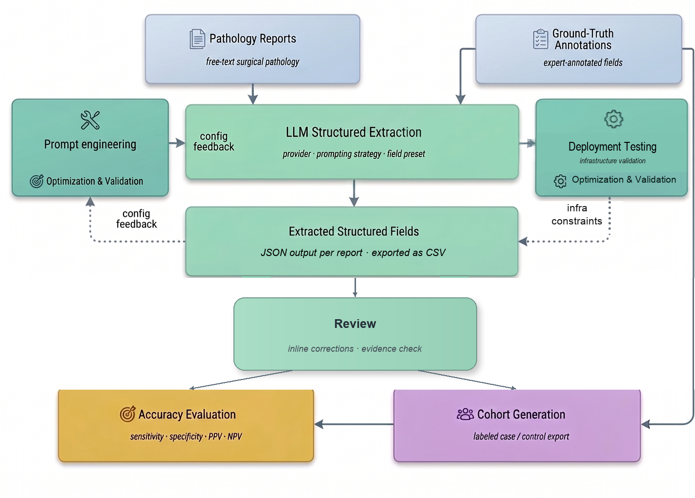
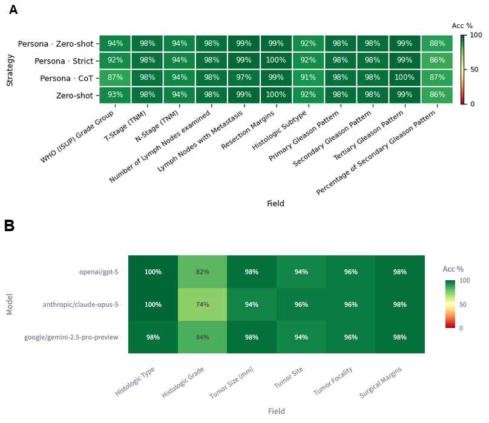
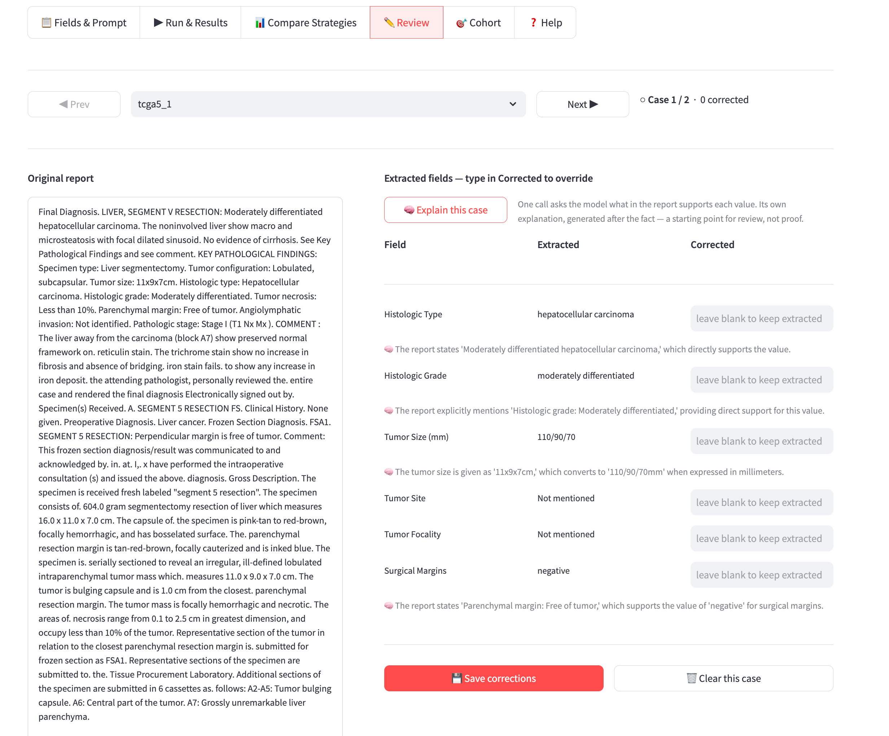

# PathEx

**A web-based, multi-strategy platform for LLM-driven structured extraction from pathology reports — no coding required.**

🔗 **Try it live:** [pathex-app.streamlit.app](https://pathex-app.streamlit.app/)


*PathEx analysis flow: reports and ground truth in, LLM extraction with your choice of strategy, extracted fields go through Review for inline correction and evidence checking, then out as accuracy metrics (including sensitivity, specificity, PPV, and NPV) and a labeled cohort export.*


*Compare tab: per-field accuracy heatmaps across prompting strategies (A) and across LLM providers (B).*


*Review-assistance process: "Explain this case" returns an explanation and a candidate quote for each field. When that quote can be located in the report text, a locate button highlights the exact span; when it can't (typical for UNSUPPORTED fields or values reached by inference), no button is shown and the field is left for closer manual review.*


*Review tab: case-level correction plus "Explain this case," an on-demand LLM call that states whether each value is a direct quote, a paraphrase, or an inference (A, B). When the model's quote can be located in the report text, a locate button highlights that exact span and scrolls to it — the pane also has free-text search and an expandable full-window view (C).*

## What it does

Surgical pathology reports contain rich structured data (tumor size, grade, stage, margins, biomarkers) locked in free text. PathEx turns that text into structured fields using an LLM, lets you benchmark different prompting strategies and providers against ground truth, and helps you build a research-ready cohort — all through a browser, without writing code.

## Features

- **Four API providers** — OpenAI, Azure OpenAI, Google Gemini, and OpenRouter (Claude, Llama, and others)
- **Eight prompting strategies** — zero-shot, chain-of-thought, chain-of-verification, and persona variants — so you can measure what actually improves accuracy on your data
- **Built-in field presets** for prostate, breast, colorectal, esophagus, liver, stomach, lung, thyroid, and tongue/oral cancers, plus custom fields for any cancer type
- **Accuracy evaluation** against your own ground-truth spreadsheet, with per-field and per-strategy accuracy heatmaps
- **Review tab** for case-by-case manual correction, with an on-demand **"Explain this case"** feature — a single LLM call that states, for every extracted field, whether the value is a direct quote, a paraphrase/unit conversion, or an inference the report doesn't explicitly state. When a field's quote can be located in the report text, a locate button highlights that exact span so you can verify the evidence directly rather than trust the explanation alone; the report pane also has free-text search and an expandable full-window view
- **PHI pre-pass** — a local regex scan that flags common identifier patterns (SSNs, phone numbers, emails, names, DOBs, addresses) in uploaded files before extraction runs
- **Consistency checker** — a local, deterministic check that flags internally contradictory extracted values (e.g. more positive lymph nodes than nodes examined)
- **Natural-language cohort builder** — describe inclusion/exclusion criteria in plain English and get back structured rules built from your own extracted fields and their vocabularies
- **Result caching** — identical report + prompt combinations are cached per account, so re-runs are instant and free

## Try it without your own data

Sample de-identified datasets are bundled under `sample_data/` — four TCGA-242 cancer types (breast, colorectal, esophagus, liver), each with matched ground-truth files — so you can try the full workflow before uploading anything of your own. The PRAD benchmark used in validation is available via its original publication (Grothey et al.) rather than redistributed here.

## Running it locally

```bash
git clone https://github.com/zhuangyh/pathex-app.git
cd pathex-app
pip install -r requirements.txt
cp .env.example .env   # fill in a shared API key if you want one; optional
streamlit run app.py
```

Without a shared key configured, each user brings their own API key via the sidebar ("My own key") — nothing is required to just try the app with your own credentials.

For deploying it (Streamlit Community Cloud or self-hosted with Docker), see the [Deployment Guide](DEPLOYMENT.md).

## Data & privacy

- **Bring de-identified or synthetic reports only.** The PHI pre-pass is a heuristic safety net, not certified de-identification — a clean scan means "no obvious red flags," not a guarantee.
- Uploaded report text is sent to whichever third-party API (OpenAI, Azure, Google, or OpenRouter) is selected for extraction.
- For processing real patient data, we recommend deploying your own instance (see above) with your institution's own API credentials, rather than using the publicly hosted demo.

## Citation

If you use PathEx in your research, please cite:

> Zhuang Y, Alami V, Feser WJ, Gao D. *PathEx: A Web-Based Multi-Strategy Platform for Large Language Model–Driven Structured Extraction from Pathology Reports.* (manuscript in preparation)

## License

See [LICENSE](LICENSE).
